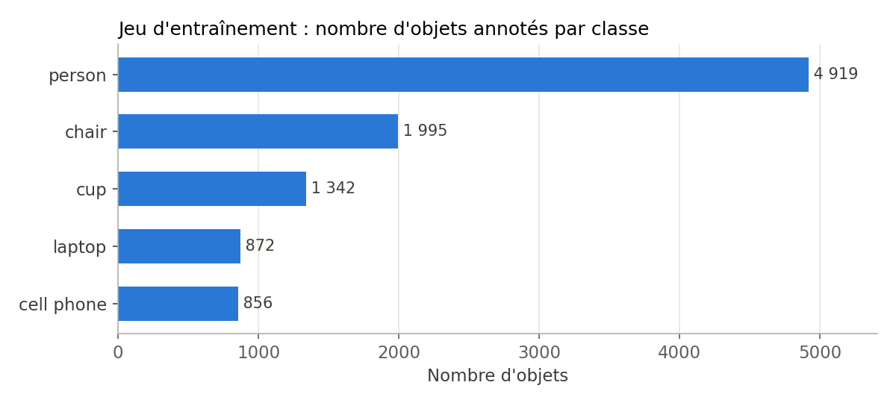
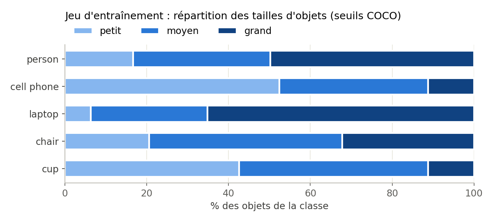

# Détection d'objets pour mesurer l'occupation des bureaux : YOLO vs Faster R-CNN

> Projet en cours de construction.

## Objectif

Avec le télétravail, les entreprises cherchent à connaître le **taux d'occupation réel** de leurs postes de travail pour adapter leurs surfaces (flex office).
Ce projet détecte, sur une image ou un flux webcam, les objets qui indiquent si un poste est utilisé.

| Classe | Rôle dans l'analyse |
|---|---|
| `person` | présence d'une personne |
| `laptop` | poste en cours d'utilisation |
| `chair` | emplacement de travail |
| `cup` | poste réservé, même si la personne est absente |
| `cell phone` | usage du téléphone |

Deux familles de détecteurs sont comparées sur **le même jeu de test** :
- **YOLO** (Ultralytics) : détecteur en une étape, rapide
- **Faster R-CNN** (torchvision) : détecteur en deux étapes, réputé plus précis

**Respect de la vie privée :** il s'agit de détection (« il y a une personne »), pas de reconnaissance (« qui est-ce »). Seuls des comptages anonymes sont conservés, jamais les images.

## Données

Sous-ensemble de **COCO 2017** limité aux 5 classes ci-dessus.

| | Origine | Images | Objets |
|---|---|---|---|
| **train** | COCO *train2017*, environ 700 images tirées par classe (rééquilibrage) | 1 782 | 9 984 |
| **val** | 15 % des images tirées, mises de côté pour suivre l'entraînement | 314 | 1 539 |
| **test** | COCO *val2017*, toutes les images contenant au moins une des 5 classes | 3 117 | 13 936 |

Le jeu de test n'a jamais été vu par les poids pré-entraînés (appris sur *train2017*). Aucune image n'est partagée entre deux jeux, ce qui est vérifié automatiquement dans le notebook.

### Analyse exploratoire





Ce qu'on en retient :
- **Déséquilibre réduit mais pas supprimé :** `person` représente 49 % des objets du train (contre 77 % dans le test, qui garde la distribution naturelle). Les résultats seront donc analysés **par classe**, et pas seulement en moyenne.
- **Petits objets :** 53 % des `cell phone` et 43 % des `cup` font moins de 32 × 32 pixels, contre 6 % des `laptop`. Hypothèse à vérifier : ce seront les classes les plus difficiles à détecter.
- **Peu d'exemples rares dans le test :** 262 `cell phone` et 231 `laptop`. La mesure sur ces classes sera moins stable que sur `person` (10 777 objets).

La liste complète des annotations utilisées (une ligne par objet) est disponible dans [`resultats/eda_annotations.csv`](resultats/eda_annotations.csv). Elle garantit la reproductibilité et sert de source pour l'analyse dans Power BI.

### Contrôles qualité

L'analyse exploratoire a permis de détecter et de corriger deux erreurs dans la préparation des données :
1. **Annotations dupliquées :** une image tirée pour plusieurs classes voyait ses boîtes fusionnées plusieurs fois (35 % de boîtes en double). Le symptôme : des comptages tous multiples de 4 sur certaines images.
2. **Fuite de données :** les images de validation restaient aussi dans le jeu d'entraînement, à cause d'une étiquette héritée du jeu COCO d'origine.

Le notebook vérifie désormais automatiquement ces deux points.

## Avancement

| Étape | Fichier | État |
|---|---|---|
| 1. Données et analyse exploratoire | [`01_donnees_et_exploration.ipynb`](notebooks/01_donnees_et_exploration.ipynb) | Fait |
| 2. Entraînement YOLO | `02_yolo.ipynb` | À venir |
| 3. Entraînement Faster R-CNN | `03_faster_rcnn.ipynb` | À venir |
| 4. Comparaison sur le jeu de test | `04_comparaison.ipynb` | À venir |
| 5. Démo webcam | `demo/webcam.py` | À venir |

## Résultats

*À venir : mAP@0.5, mAP@0.5:0.95, mAP par classe, vitesse (images par seconde) et taille des modèles.*

## Structure du dépôt

```
notebooks/   notebooks Google Colab, à exécuter dans l'ordre
resultats/   métriques et graphiques (CSV, PNG)
demo/        script de démonstration webcam (OpenCV)
```

## Lancer le projet

Ouvrir les notebooks dans [Google Colab](https://colab.research.google.com/) (*Fichier > Ouvrir un notebook > GitHub*) et les exécuter dans l'ordre. Les données et les poids des modèles sont stockés sur Google Drive, pas dans ce dépôt.

## Auteur

Adrien Brouard, Data Analyst - [github.com/Dramasys](https://github.com/Dramasys)
